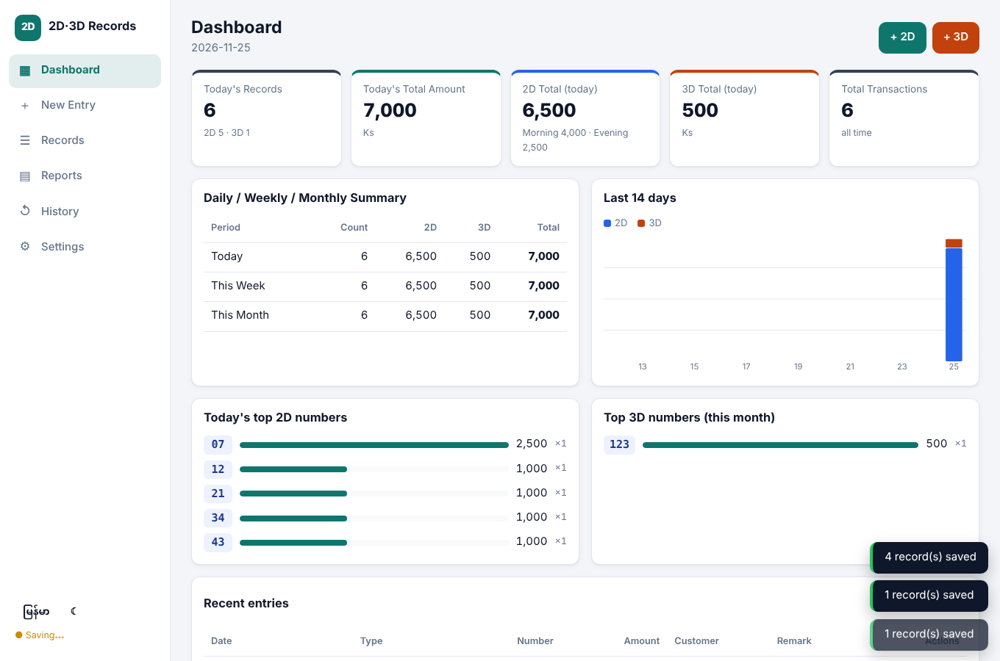

# Myanmar 2D & 3D Number Record Manager

Offline app for recording, managing, calculating and reporting **2D (00–99)** and **3D (000–999)** number records.
English / မြန်မာ (Unicode) · Light / Dark mode · Mobile-friendly · SQLite database · Excel, PDF and print reports.

| Ready-to-use file | Platform |
|---|---|
| `release/MyanmarNumberRecord-v1.0.0.apk` | Android 6.0+ phones and tablets |
| `release/MyanmarNumberRecord-Desktop.html` | Windows / macOS / Linux: double-click it to open in Chrome or Edge. No installation or internet needed. |



## Documents

| File | Contents |
|---|---|
| [docs/INSTALL.md](docs/INSTALL.md) | Installation guide (Android, desktop) and building from source |
| [docs/USER_MANUAL.md](docs/USER_MANUAL.md) | User manual: English + မြန်မာ |
| [docs/DATABASE.md](docs/DATABASE.md) | Database structure (tables, constraints, indexes, queries) |
| [docs/ARCHITECTURE.md](docs/ARCHITECTURE.md) | Application architecture and source code layout |
| [docs/TEST_RESULTS.md](docs/TEST_RESULTS.md) | Automated test results |

## Features

- **Dashboard**: today's records, total, 2D total (morning/evening), 3D total, all-time transactions, daily/weekly/monthly summary, 14-day chart, top numbers, recent entries.
- **Entry**: 2D (date, Morning/Evening, number, amount, customer, remark) and 3D (date, number, amount, customer, remark). You can enter several numbers at once (`12 34 56`), add reverses with **R** (12 → 21) or all 3D permutations (123 → 6 numbers), use quick amount buttons, and pick customers from autocomplete. Myanmar digits (၁၂) are accepted.
- **Validation**: numbers must be exactly 2 / 3 digits, and amounts whole Kyat from 1 to 100,000,000. Dates are checked. The database enforces the same rules with CHECK constraints.
- **Duplicate protection**: a warning before saving a record identical to an existing one (date, session, number, amount, customer), and double-taps on Save are blocked.
- **Records**: search by number (exact or contains), filter by date range, 2D/3D, session and customer, sort, page through results, see totals, edit, delete, bulk delete, and export to Excel.
- **History**: every add, edit and delete is logged, and deleted records can be restored.
- **Reports**: daily report, totals by number (with a 00–99 grid), by date, by session, monthly, and customer summary. Each one can be exported to **Excel (.xlsx)** or **PDF**, or printed.
- **Backup / Restore**: download the complete SQLite database and restore it (the file is validated first, and a safety snapshot is taken). Automatic daily snapshots cover the last 7 days.
- **Settings**: language, theme, business name on reports, duplicate warning on/off, sample data, delete all (you must type DELETE to confirm).

## Quick start for developers

```bash
npm install
```

```bash
npm run dev
```

```bash
npm test
```

```bash
npm run build && npm run build:single && npm run e2e
```

```bash
npm run android:apk
```

`npm run android:apk` needs the Android SDK. The output is `android/app/build/outputs/apk/debug/app-debug.apk`.

Technology: React 18 + TypeScript + Vite, SQLite (sql.js / WebAssembly), SheetJS (Excel), jsPDF + html2canvas (PDF), Capacitor 7 (Android).
